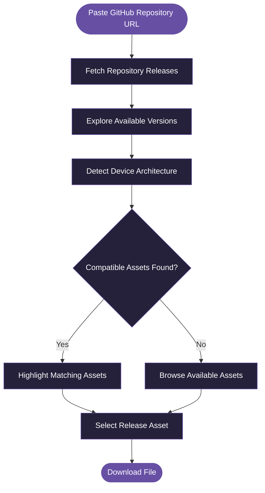

 <div align="center">


### Find your release. Match your device. Get it done.

**A smarter GitHub release discovery and download experience, built for Android.**

Explore public repositories, discover release assets, identify architecture-compatible packages, and download files — all through one thoughtfully designed application.

<br/>

<a href="https://github.com/Tombytee/ReleaseFetch-Update/releases/latest">

</a>
&nbsp;
<a href="https://github.com/Tombytee/ReleaseFetch-Update">

</a>

<br/><br/>


<br/>

<sub>DISCOVER &nbsp; / &nbsp; MATCH &nbsp; / &nbsp; DOWNLOAD</sub>

</div>

---

## The Experience

### GitHub has the releases. ReleaseFetch finds your way through them.

Downloading Android applications from GitHub can involve more work than it should.

Different versions, multiple release assets, unfamiliar architecture labels and endless filenames turn a simple download into a guessing game.

ReleaseFetch is built to make that experience more straightforward.

Paste a public GitHub repository URL, explore its releases, and let intelligent architecture matching help you identify the appropriate assets for your device.

**Less manual searching. More clarity.**

## Designed Around What Matters

<div align="center">

### A focused toolkit for GitHub release downloads.

</div>

<table>
<tr>
<td width="50%" valign="top">

**01 / REPOSITORY DISCOVERY**

### Connect to GitHub

Paste a public repository URL and retrieve its available releases without manually navigating GitHub's web interface.

</td>
<td width="50%" valign="top">

**02 / INTELLIGENT MATCHING**

### Find compatible assets

Automatically detect your device architecture and highlight matching release assets.

</td>
</tr>
<tr>
<td width="50%" valign="top">

**03 / DOWNLOAD EXPERIENCE**

### Download in one place

Download selected release files directly within the application, keeping the workflow convenient and organized.

</td>
<td width="50%" valign="top">

**04 / VERSION MANAGEMENT**

### Stay up to date

An integrated update checker helps you discover newer versions of ReleaseFetch.

</td>
</tr>
<tr>
<td width="50%" valign="top">

**05 / RELEASE EXPLORATION**

### Browse with clarity

Explore release versions and associated downloadable assets in a structured interface.

</td>
<td width="50%" valign="top">

**06 / MODERN INTERFACE**

### Built for Android

A clean and adaptive Material 3 interface designed around a comfortable mobile experience.

</td>
</tr>
</table>

## The Architecture Advantage

### Stop guessing which APK your device needs.

Android release assets can be built for different CPU architectures. Downloading an incompatible package can lead to installation or compatibility problems.

ReleaseFetch helps simplify the selection process by detecting your device architecture and highlighting matching assets.

| Architecture | Description |
|:---|:---|
| `arm64-v8a` | 64-bit ARM devices |
| `armeabi-v7a` | 32-bit ARM devices |
| `x86_64` | 64-bit x86 devices |

<blockquote>

**The idea is simple:** Instead of making users figure out every architecture label themselves, ReleaseFetch does the matching work and makes suitable options easier to identify.

</blockquote>

## A Simpler Workflow

### From repository URL to downloadable asset.



One application. A more organized download process.

## Getting Started

### Your next download is just a few steps away.

<details>
<summary><b>01 — Download the application</b></summary>

Visit the official [ReleaseFetch Releases](https://github.com/Tombytee/ReleaseFetch-Update/releases/latest) page.

Download the latest APK from the release's **Assets** section.

</details>

<details>
<summary><b>02 — Install on Android</b></summary>

Open the downloaded APK and follow the Android installation instructions.

You may need to enable permission to install unknown apps for your selected browser or file manager.

</details>

<details>
<summary><b>03 — Discover your first release</b></summary>

Launch ReleaseFetch, paste a public GitHub repository URL and explore its available releases.

Select an appropriate asset and start downloading.

</details>

<div align="center">

<a href="https://github.com/Tombytee/ReleaseFetch-Update/releases/latest">

</a>

</div>

## Project Specifications

| Property | Information |
|:---|:---|
| Application | ReleaseFetch |
| Current Version | 1.5 |
| Target Platform | Android |
| Design System | Material Design 3 |
| Release Provider | GitHub Releases API |
| Distribution Format | APK |

## Built in the Open

### Contributions are always welcome.

ReleaseFetch is an open-source project, and community contributions can help improve its functionality, reliability and overall experience.

Whether you're fixing an issue, suggesting an improvement or contributing code, you're welcome to participate.

**Contribution workflow**

1. Fork the repository.
2. Create a feature branch:
   ```bash
   git checkout -b feature/YourFeature
   ```
3. Commit your changes:
   ```bash
   git commit -m "Add: YourFeature"
   ```
4. Push your branch:
   ```bash
   git push origin feature/YourFeature
   ```
5. Open a Pull Request with a clear explanation of your contribution.

### Have something to report?

| Feedback | Where to go |
|:---|:---|
| 🐛 Bug Report | [Open an Issue](https://github.com/Tombytee/ReleaseFetch-Update/issues/new) |
| 💡 Feature Suggestion | [Suggest an Improvement](https://github.com/Tombytee/ReleaseFetch-Update/issues/new) |
| ⭐ Project Support | [Star on GitHub](https://github.com/Tombytee/ReleaseFetch-Update) |

---

<div align="center">


<br/>

### Thoughtfully built. Open-source at heart.

# ReleaseFetch

**Designed & Developed by Subham Kumar Prusty**

<sub>Making GitHub release downloads simpler, one asset at a time.</sub>

<br/><br/>

<a href="https://github.com/Tombytee/ReleaseFetch-Update">SOURCE CODE</a>
&nbsp; · &nbsp;
<a href="https://github.com/Tombytee/ReleaseFetch-Update/releases">ALL RELEASES</a>
&nbsp; · &nbsp;
<a href="https://github.com/Tombytee/ReleaseFetch-Update/issues">SUPPORT</a>

<br/><br/>

**Enjoying the experience? Leave a ⭐ on GitHub.**


</div>
